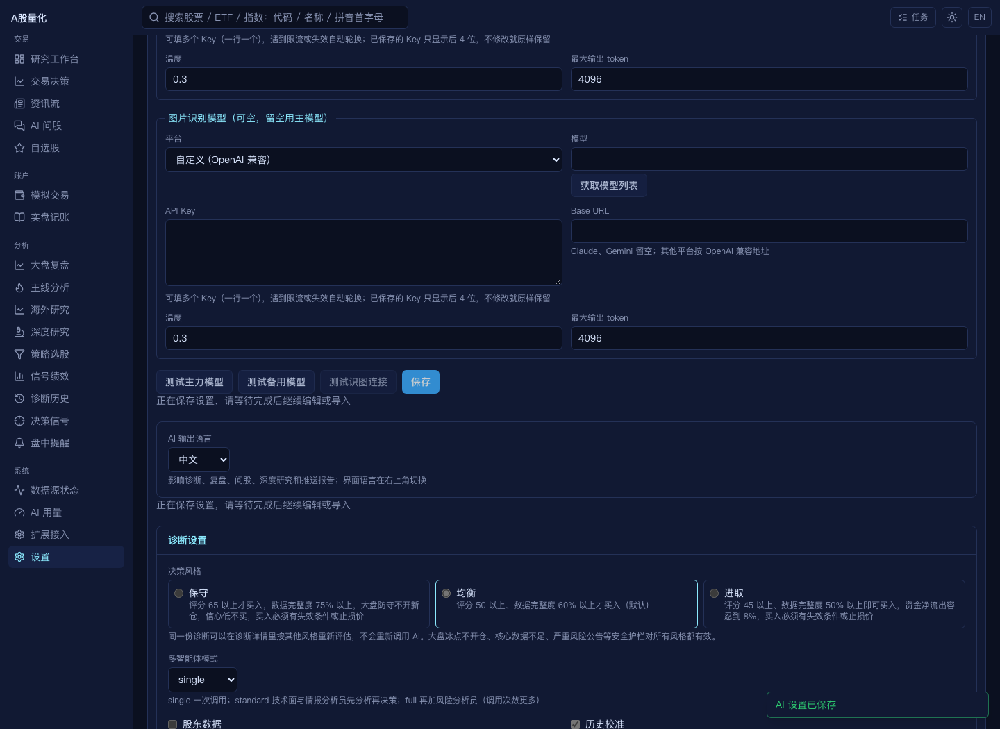
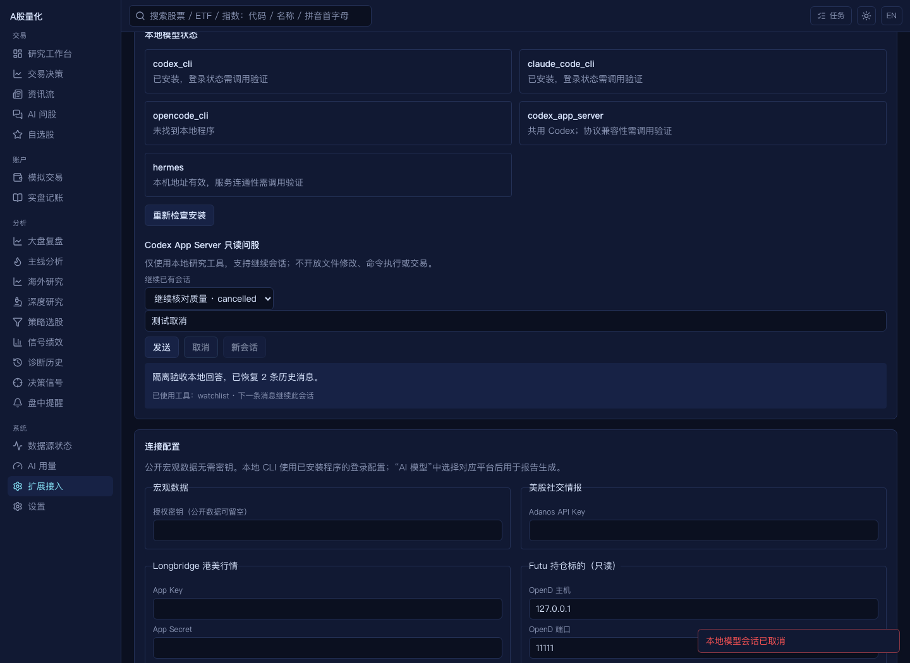
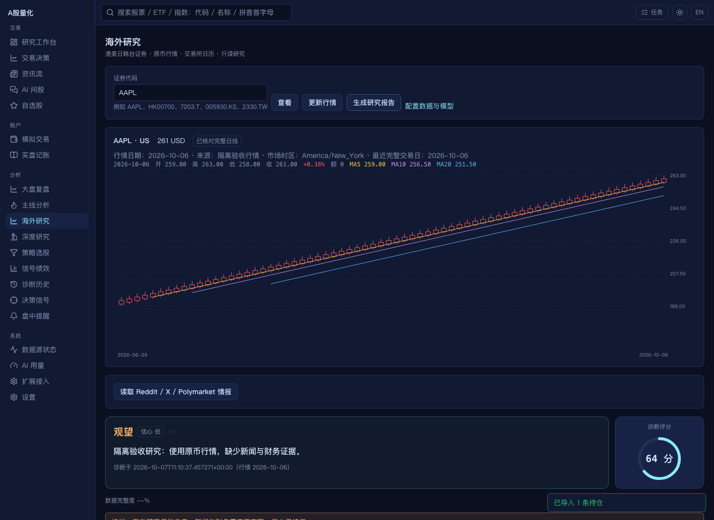

# 本轮 DSA 对齐实现与验收

本轮完成[发布后复核](dsa_alignment_postrelease_2026-10-07.md)确认的 R01–R08，以及用户选择全部引入的 E1–E6。参考仓库固定为 [daily_stock_analysis `ce364e4`](https://github.com/ZhuLinsen/daily_stock_analysis/tree/ce364e457aab288863a5707e7b3df79786ad07f2)，本地起点为 `7593d76`。这里的“完成”指下表明确列出的功能、入口和离线验收；不等于对未来上游提交或所有付费服务作可用性保证。

## 八项质量修复

| 编号 | 最终行为 | 主要证据 |
| --- | --- | --- |
| R01 | 共享证据包和选股证据携带市场阶段；缺有效交易日期时保留受限状态，旧行情不再标为可用 | `tests/test_postrelease_alignment.py`；`research_artifact.py`、`data_freshness.py` |
| R02 | 未验证日历不终结后验；当前引擎升级到 daily-return-v4，补齐日历后再计算；海外按本市场日历计算 | 后验日历恢复、美国劳动节跳日、历史盘中缓存不能变成完整日线的回归 |
| R03 | 旧策略版本、旧后验版本和未验证样本不参与当前权重；同证券同日去重，样本不足或覆盖不足保持中性 | 当前版本/日历测试；30 条命中、70 条不可评估时权重仍为 1 |
| R04 | 复盘展示总数、完成、不可评估、等待和覆盖率；低覆盖只观察、不修改信心；策略展示 1/3/5/10 日窗口 | 信号 3/20 可评估的回归；Signals 页面 |
| R05 | 歧义确认保留原句已明确标的和顺序；多标的实际执行覆盖股票、海外证券 | `test_web_intent_stages.py`、`test_postrelease_alignment.py` |
| R06 | 保存后的设置 GET 刷新纳入编辑/导入锁；刷新结束后输入的新草稿不被覆盖 | `settings-refresh.test.tsx`；真实浏览器延迟 GET、切页导入及再次保存 |
| R07 | ETF 真实持仓进入研究概览；过期 active 信号从有效集合过滤，页面显示有效期；海外持仓使用一致 held/holdings 结构 | 研究概览回归；`signals?valid_only=true` |
| R08 | A 股时钟统一到 Asia/Shanghai；同一瞬间的 UTC/市场时区输入得到一致阶段 | 时区回归；海外使用各交易所时区，识别节假日和午休 |

## 六类扩展

| 编号 | 已实现范围 | 入口与验证 |
| --- | --- | --- |
| E1 海外研究与组合 | 港美日韩台身份、日历、币种；Yahoo 与 Longbridge 日线；独立行情缓存；诊断和结构化报告；自选股/直接诊断/命令行共用入口；Futu 只读持仓标的；持仓与成交 CSV、去重和整批校验；原币及有质量门槛的 CNY 估值 | “海外研究”、股票详情、海外 API；预览无写入、确认导入、缺 FX 不合计、合成汇率估值、报告渲染、手机宽度截图 |
| E2 宏观工具 | 固定 FXMacroData v0.1.0 公开客户端的全部 72 项目录及嵌套参数；界面执行与 AI 原生工具；主机注入密钥、校验参数、保留来源 | “扩展接入”、`/integrations/macro/*`；72 项 schema 和异常/凭据回归 |
| E3 本地模型 | Codex CLI、Claude Code CLI、OpenCode CLI；Hermes 本地 HTTP；Codex App Server 本地研究工具循环、隔离权限、超时、取消、历史恢复、运行诊断 | 模型设置与“扩展接入”；真实临时进程协议测试；本机 Codex 无模型调用握手成功；浏览器恢复/取消且历史不污染 |
| E4 外部助手 | OpenClaw 和 Grok Bot Skill、共享 REST 示例客户端；令牌认证、原任务继续等待、有效信号过滤 | `integrations/openclaw/`、`integrations/grok_bot/`、`integrations/assistant_client.py`；协议与不重复提交回归 |
| E5 通知与语言情报 | 飞书/Lark App Bot 主动卡片及图片；Slack Bot 同频道文字/图片；AstrBot 签名适配器；韩文模型输出；Adanos Reddit/X/Polymarket 分渠道证据 | 推送设置、报告语言、美股情报入口；HTTP 替身验证上传/频道/签名、部分失败与语言指令 |
| E6 近分候选轮换 | 匿名 seed，只轮换末端近分且符合市场/模型约束的候选；保留优先候选，不改原分；比例 0 关闭 | 设置页、同步/后台选股接口；边界与可复现选择回归 |

配置方法、外部助手安装步骤和 CSV 格式见[扩展接入指南](integrations.md)。配置示例已补齐默认值；本轮只新增表和字段，不执行破坏性迁移。

## 验收结果

- 后端：完整 `tests/` 套件 2104 项通过，6 项为第三方弃用警告；详见 [verification.json](audits/dsa-full-alignment-2026-10-07/verification.json)。
- 前端：45 个文件、192 项测试通过；ESLint 和生产构建通过。新增取消任务回归，避免用户取消后出现未处理 Promise 异常。
- 桌面端：24 项测试通过，包含后台启动、端口占用和健康检查；本机端口测试在允许监听回环地址的环境运行。
- Chromium：设置慢刷新期间禁止编辑和导入，下一次编辑保存保留；韩文设置持久化；72 项目录及宏观查询；本地会话继续、刷新恢复和取消；海外 CSV 预览/确认、缺汇率与有效估值、Futu 标的、研究报告、海外详情入口；未处理页面异常为 0。
- 本机 Codex App Server：实际 initialize 和 thread/start 成功，返回 `quant_research` 只读权限；未开始模型回合，未继承登录凭据。动态工具与注入历史字段另按本机生成的 JSON Schema 核对。
- 静态检查：Python 编译、YAML 解析、默认策略资源验证、`git diff --check` 通过。

浏览器只使用临时配置、临时数据库和模拟外部响应，不会发送真实通知、调用付费模型或执行订单。可复现脚本为 `scripts/dsa_extension_smoke.py`，数据替身由专用环境开关加载。

证据目录：[本轮验收产物](audits/dsa-full-alignment-2026-10-07/)，其中 [results.json](audits/dsa-full-alignment-2026-10-07/results.json) 为浏览器实际结果。

## 三平台与部署兼容

Longbridge 5.x Linux wheel 要求 glibc 2.39，不能直接用于原 Ubuntu 22.04 和 Debian 12。保留这两个系统基线，Linux 桌面与 Docker 使用 Python 3.11 + Longbridge 0.2.74；Windows/macOS 继续新版 SDK。适配器同时支持旧构造函数与新工厂方法。

已实际下载并验证兼容版 Linux amd64/arm64 wheel 可解析；核对 Windows/macOS 新版 wheel 的公开发行元数据。SDK 两代接口均有离线回归。PyInstaller 增补日历、宏观目录和 SDK 资源，打包自检加载日历、宏观目录和 Longbridge 原生依赖，并检查 Futu 包是否存在；安装包 API 冒烟也加入新接口。详见 [dependency-platforms.json](audits/dsa-full-alignment-2026-10-07/dependency-platforms.json)。

本轮未发布 GitHub 版本，也未在 Windows/Linux 真机生成或启动新安装包。平台元数据、离线回归与本机源代码运行不能替代 CI 的完整三平台构建和安装验收。

## 功能边界

- 海外引擎是证券研究与持仓估值，不进入国内自动订单；新闻/财务覆盖不完整时明确低信心，缺价或缺 FX 不用成本价拼合市值。成交账本不计算完整税费与现金损益，同日无时间字段的交易按 CSV 顺序回放。
- Futu/Longbridge、Adanos、授权宏观数据、真实通知与外部助手部署需要使用者的服务权限，本轮未进行带真实凭据的端到端调用。
- CLI 仅文本生成；Hermes 不提供原生工具、视觉或流式能力。App Server 只开放文档中的本地只读研究工具，72 项联网宏观工具由原有 AI 工具链提供。
- 韩文用于模型生成文本；JSON 键、动作与信心枚举保持稳定。固定界面文案仍由现有中英文界面语言控制。
- 旧报告与旧后验保留供查看，但不能绕过当前版本和数据质量门槛参与自动调权。
