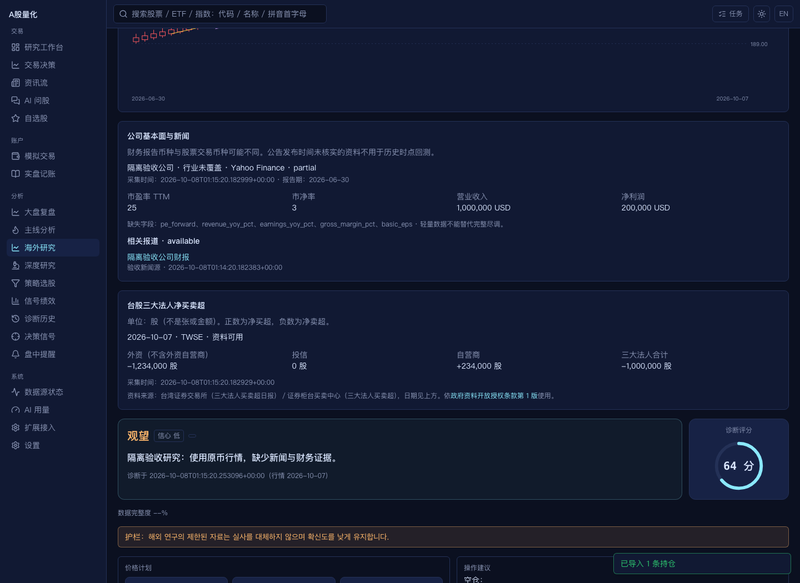
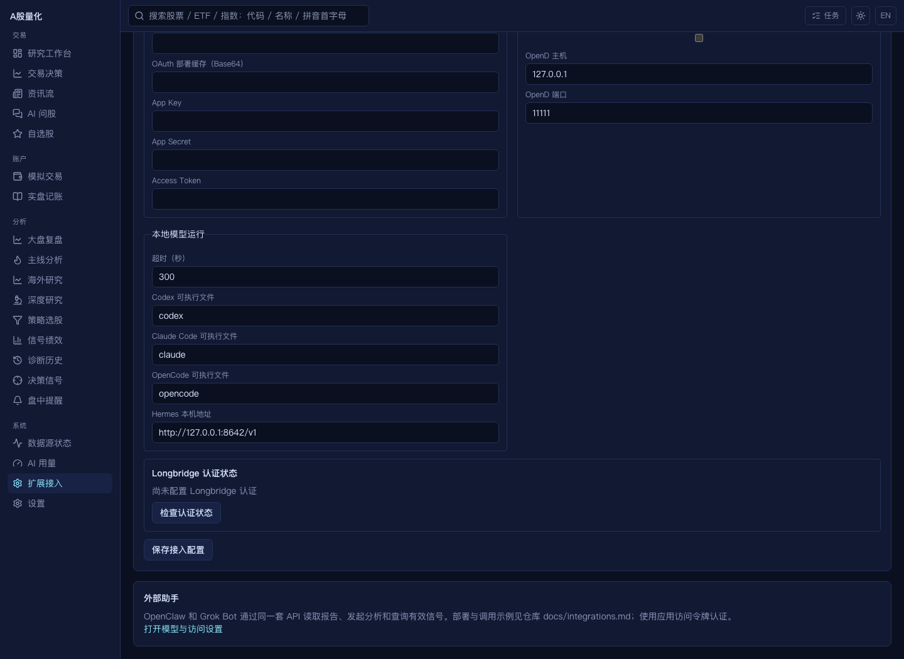

# DSA 运行入口继续对齐

参考上游固定提交 `ce364e457aab288863a5707e7b3df79786ad07f2`；本轮再次查询 GitHub 主分支，未发生变化。以下是对前轮功能范围的进一步补齐，不把模拟验收当成真实供应商可用性证明。

## 已落实的补充

1. 本地 CLI/Hermes 在问股页使用普通完成接口，再把结果交给流式页面。不会请求供应商不支持的原生流式能力。韩文语言指令覆盖普通问答和流式页面。相关回归 54 项通过。
2. 海外常用证券名称和别名接入搜索、问股识别和自选股导入。日韩种子表保留 MIT 许可来源；桌面打包包含索引资源。代码后缀完整保留，A 股 `.SH/.SZ/.BJ` 不会误识别为美股代码。
3. 海外轻量财务、估值、分红、新闻接入页面和诊断证据包。保留原始币种、报告期、来源、采集时间、缺失及过期状态。阶段超时后不会延迟写入，失败保留旧数据和旧时间。该组后端回归 102 项、前端检查及构建、隔离浏览器验收通过。
4. 复盘支持 CN/HK/US/JP/KR/TW，各自显示指数、交易日和质量。区域缓存按市场、日期和输出语言隔离；未知日历和全失效行情拒绝生成。单指数失败可降级生成，全部失败不覆盖历史结果。韩文复盘使用韩文固定标题。
5. 复盘页面支持市场切换、各市场分享图和定时地区设置。默认只开启 CN；`market_review.regions` 支持列表或逗号字符串，兼容上游 `both`（CN/HK/US/JP/KR）。地区切换时旧请求不能覆盖新地区的页面。
6. 定时复盘分别检查海外交易日，中国休市不会阻断海外地区；单市场失败继续后续地区。普通日报只使用各市场当前应有交易日的报告，中国休市时单独推送成功的海外复盘。运行时仍遵循已配置的推送开关和渠道。
7. 海外盘中快照与完整日线分开保存、展示和进入证据包；按供应商报价时间计算 15 分钟时效，显示可能延迟。缺币种、未来时间、旧于已有报价或请求失败均不覆盖有效缓存。日韩收盘竞价阶段仍使用上一完整交易日，不能提前视为收盘。
8. 可在扩展接入开启 Futu 港股基本面，只连接本机 OpenD 行情接口。公司资料、财务、分红、估值分块处理；Yahoo 补齐缺项时检查报告期和报告币种，保留字段来源。Futu 未启用或非港股时不会访问 OpenD。该组 97 项后端回归、前端检查和构建、浏览器开关及快照验收通过，见[证据](audits/dsa-overseas-live-2026-10-08/results.json)。
9. 韩文诊断、自选仪表盘和复盘增加固定标题、动作显示及动态风控说明；策略审议明确韩文输出并保留原枚举。盘前/休市的韩文即刻交易建议执行相同护栏，否定句保留原意。自选报告保存输出语言，模板预览及示例模板使用该语言的内置格式。相关中英韩回归 216 项通过。证券名称、历史资料、源证据和自定义模板文字不自动翻译。
10. Longbridge 增加 OAuth Client ID、SDK 缓存、部署 Base64 缓存及同名上游环境变量。后台不进入交互式登录；缓存失效时明确要求重新授权，完整旧版凭据仍可回退。部署缓存按摘要只导入一次，保留 SDK 刷新后的 token；配置和错误信息脱敏。扩展接入页显示真实 SDK 能力与缓存状态，并提供交互式授权脚本。
11. 台湾上市／上柜三大法人资料接入海外证据、页面、模型提示、结构化报告、Markdown／图片和自选股报告。严格校验 TWSE 列名、TPEx 民国日期、股数单位及请求交易日；保留负号和零，缺失不伪装成零、官方合计不自行编造。全市场缓存、请求合并、限流和熔断按来源隔离；失败保留历史资料与原日期。
12. 修复海外报告导出误用 A 股专用字段导致“诊断记录数据不完整”的问题。海外报告保留原币、研究逻辑、风险、法人证据和中英韩固定文案；页面结果字段也补齐，研究正文不再仅保存而不显示。

## 运行说明

在【大盘复盘 → 定时复盘范围】选择地区，执行时间仍取【设置 → 定时任务】中的每日报告时间。海外市场尚未收盘时，报告使用上一完整交易日。各地假期依据本地交易所日历；日历不可用时不将工作日当作完整性证明。

海外指数单位为点；不从 A 股复制市场宽度、北向资金或涨跌停统计。新闻属于采集时的背景资料，不能冒充行情日期的历史证据。海外报告提供研究观察，不套用 A 股仓位护栏。

基础面和新闻的浏览器证据见 [结果](audits/dsa-runtime-alignment-2026-10-08/results.json) 和 [页面截图](audits/dsa-runtime-alignment-2026-10-08/overseas.png)。验收使用临时配置和数据库、模拟行情与模型，未发送真实通知。

## 完成范围与兼容边界

针对固定上游 `ce364e4`，前轮 R01–R08、E1–E6 清单及本次运行入口补充已落实并完成本机可执行验收。旧报告保留发现时的历史证据，当前结果以本文和[前轮范围矩阵](dsa_full_alignment_2026-10-07.md)共同为准。

Linux 兼容版桌面／Docker 保留 Ubuntu 22.04／Debian 12 基线，附带旧 Longbridge SDK，仅支持旧版三件套凭据；OAuth 需新版 SDK。Windows/macOS 使用新版 SDK，Linux 源码部署可使用 Python 3.12+ 和 glibc 2.39+。界面显示此实际能力，不会把缺少 OAuth 的运行环境标成已支持。

本次实测 macOS arm64 后台与 Electron 应用、Linux arm64 Docker。Windows、macOS x64 和 Linux 桌面仍需后续发布 CI 构建和真机安装验收。带真实凭据的券商授权、付费模型和通知投递没有执行；源码接口及离线协议测试不能替代这些账户权限验收。本轮未推送或发布新版本。

## 前轮验证

在 `651206f` 上，后端全部 **2146 项通过**（6 项第三方弃用警告），前端 **46 文件 / 195 项通过**，ESLint 与生产构建通过，桌面端 **24 项通过**。修改过的 Python 模块另按 Python 3.11 语法检查通过。详见 [verification.json](audits/dsa-runtime-alignment-2026-10-08/verification.json)。

全量回归还修复了海外别名抢占国内名称前缀排序的问题；组合风险测试的行情样本设置明确盘后采集时间，避免早上运行时被时效护栏正确判为未完成日线。生产时效规则保留。以上变更均已本地提交，尚未推送或发布。

## 最终验证

代码提交：`c05b8ba`（OAuth）、`b5121dc`（法人证据与报告）、`f43f010`（复盘测试桩）。

| 检查 | 实际结果 |
| --- | --- |
| 后端完整 tests/ | **2185 passed**，6 条第三方弃用警告 |
| 前端完整测试 | **47 文件 / 198 passed**，ESLint、TypeScript、生产构建通过 |
| Electron 逻辑回归 | **24 passed** |
| Python 兼容和默认资源 | 19 个改动模块按 Python 3.11 语法通过；默认策略资源检查通过 |
| 隔离 Chromium | OAuth 状态、台股负值/零值、报告、此前扩展路径均通过；未捕获页面异常 0 |
| macOS arm64 冻结后台 | PyInstaller 构建、7 项资源自检、任务入口、新增 API 和日/韩/台名称检索均通过 |
| macOS arm64 Electron | 应用构建、`codesign --verify --deep --strict`、真实启动、preload 桥接、临时数据目录、新页面通过；退出后后台结束 |
| Linux arm64 Docker | 当前源码镜像构建成功；无网络容器自检、Web/API、资源和新增路径通过；外部请求仍要求认证 |
| 台湾公开接口只读探测 | TWSE `2330.TW`、TPEx `6488.TWO` 均取得 `2026-10-07` 对应资料，单位 shares；TPEx 首次失败后重试恢复 |

前端完整测试发现旧分享图测试桩未提供新增复盘设置接口；已补真实响应结构并等待设置初始化，防止异步错误被提前完成的断言掩盖。

Docker 测试容器及匿名卷已删除，验证镜像 `quant-tools:dsa-oct8-validation` 保留在本机；Electron 产物位于 `apps/desktop/dist/mac-arm64/AStockQuant.app`，未执行上传。图形验收使用临时数据，未调用付费模型或发送通知。

完整证据：[verification.json](audits/dsa-oauth-taiwan-2026-10-08/verification.json)、[浏览器交互](audits/dsa-oauth-taiwan-2026-10-08/results.json)、[桌面实际启动](audits/dsa-oauth-taiwan-2026-10-08/electron-result.json)、[容器接口](audits/dsa-oauth-taiwan-2026-10-08/docker-runtime.json)。

